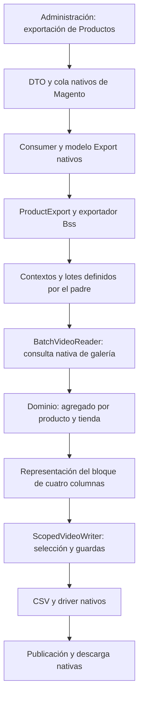

# Arquitectura técnica

## Responsabilidad del módulo

`LeanCommerce_ProductVideoExport` calcula información efectiva de videos por producto y tienda y la incorpora a la exportación de productos de Magento. El código pertenece a Grupo Dico. No persiste atributos derivados, no escribe catálogo o galería y no incorpora tablas, rutas públicas, configuración de negocio, permisos, cron ni consumidores de cola propios.

El módulo depende de `Bss_CustomProductAttributeExport`: `Model\ProductExport` extiende su exportador de productos. La entidad `catalog_product` se registra con esa subclase mediante `etc/export.xml`; se conservan las cabeceras y los datos del padre. No se modifica código de Magento ni de Bss.

Esta descripción corresponde al código en construcción, todavía sin versión publicada. Los límites de prueba están en la [matriz de compatibilidad](guia-api-y-compatibilidad.md#plataforma-y-verificación).

## Flujo de datos



Una solicitud sin el parámetro nuevo se delega al exportador padre. Una solicitud enriquecida conserva el universo de contextos y el avance de lotes del padre, calcula un único resultado por contexto y utiliza ese resultado tanto para las columnas como para el filtro.

## Componentes

| Componente | Responsabilidad |
|---|---|
| `Domain\VideoAssociation`, `VideoMetadata` | Representar identidad y valores de galería, distinguiendo nulo, cero y cadena vacía |
| `Domain\VideoAggregator`, `VideoResult` | Elegibilidad, conteo, orden compartido y resultado de cuatro campos |
| `Domain\VideoListCodec` | Normalización de títulos y codificación/decodificación de listas |
| `Domain\VideoPresence`, `VideoRepresentation` | Selección por conteo y representación diferencial o explícita |
| `Api\VideoReaderInterface` | Contrato de lectura por lote y tienda |
| `Model\ResourceModel\BatchVideoReader` | Componer la consulta de galería de Magento y convertir sus resultados al dominio |
| `Model\ProductExport` | Integrar los bloques antes de que el padre suprima filas heredadas; añadir cabeceras sin colisiones |
| `Model\PresenceParameters` | Validar el parámetro en los formatos nativos de petición y DTO |
| `Model\Source\VideoPresenceOptions`, `Plugin\ExportFilterPlugin` | Traducir la etiqueta propia antes de preparar la cuadrícula y mostrar las tres opciones mediante el control nativo de Administración |
| `Model\ScopedVideoWriter` | Diferir cabeceras, seleccionar filas y comprobar la integridad antes de devolver contenido |
| `Model\ExportExecutionContext`, `ScopedExportLogger` | Mantener estado fatal por ejecución y detectar errores capturados por el padre |
| `Model\ScopedAdapterFactory`, `OwnedCsv`, `CsvFileClaim`, `CsvCleanupRegistry`, `CsvCleanupScope` | Registrar propiedad y limpiar únicamente temporales propios del flujo enriquecido |
| `Plugin\ExportCleanupPlugin`, `ConsumerCleanupPlugin` | Delimitar el ciclo de archivos directo o de cola alrededor de las operaciones nativas |

El dominio no depende de Magento, SQL, filesystem, logging o repositorios. Sus reglas se prueban sin arrancar Magento.

## Lectura de galería y herencia

El lector reutiliza `Magento\Catalog\Model\ResourceModel\Product\Gallery::createBatchBaseSelect`, incluidos los cambios de consulta aportados por ProductVideo. Conserva las expresiones nativas que resuelven herencia de cada campo. Restringe la proyección a identidad de producto/asociación, tipo, habilitación, posición, URL y título, y limita los identificadores al lote actual.

La lectura compone SQL de los recursos de Magento por rendimiento: evita cargar productos adicionales y consultar cada SKU por separado. El exportador padre conserva sus propias cargas para los demás campos. Se utiliza una consulta por lote y tienda; un lote vacío no consulta. El identificador de `media_gallery` se resuelve mediante EAV y el campo de enlace mediante `MetadataPool`; no se fijan identificadores de atributo ni se supone siempre `entity_id`.

Las tablas de galería, asociaciones, valores por tienda y metadata de ProductVideo son fuentes de lectura. No se ejecutan escrituras SQL. No se utiliza `GROUP_CONCAT`, por lo que el módulo no impone el límite de esa función a las listas.

Se admiten asociaciones `external-video` globalmente habilitadas y habilitadas en el contexto efectivo. Un valor nulo de tienda hereda de base; un título vacío o una posición cero son explícitos. Una deshabilitación global no puede revertirse localmente. Una deshabilitación en base sí puede tener un valor local habilitado.

El agregado identifica asociaciones por `value_id` dentro de un producto. Repeticiones exactamente iguales se consolidan; valores contradictorios para la misma identidad provocan error. Se comparan valores estrictamente, evitando equiparar nulo, cero, cadena vacía o cadenas numéricas diferentes. URLs iguales de asociaciones distintas permanecen separadas.

La posición efectiva determina el orden, con nulos al final y `value_id` como desempate. La misma secuencia produce las listas de URL y títulos. Una URL faltante conserva su posición y conteo; se registra una anomalía acotada sin volcar URL o títulos completos.

## Integración con filas y cabeceras

`ProductExport` obtiene los datos del padre y modifica su mapa antes de la supresión nativa de filas. Esto permite conservar una fila cuya única diferencia sean los videos. Las columnas de contexto se restauran por el mecanismo nativo; no se fabrican filas al final del archivo ni una fila por video.

En **Todos**, se escribe un bloque completo para base, tiendas distintas de base o contextos sin base disponible. Las tiendas iguales a una base presente omiten las cuatro claves. Omitir claves conserva la posibilidad de que el core suprima una fila vacía; insertar cuatro cadenas vacías en esa etapa cambiaría ese comportamiento.

En **Con video** y **Sin video**, todos los contextos recibidos se materializan antes de delegar la escritura. El writer filtra utilizando el conteo ya calculado. Así, un lote inicial sin coincidencias sigue contando como procesado para el padre y no detiene el recorrido antes de encontrar coincidencias posteriores.

Las cabeceras parten del resultado completo del padre; se añaden cuatro nombres al final y se rechaza cualquier colisión. No se fija la cantidad de columnas existentes ni se reemplaza la composición de personalizadores de Bss/Magento.

## Serialización y archivos

`ScopedVideoWriter` decora el adaptador recibido sin llamar al constructor de `AbstractAdapter`, evitando crear otro temporal. Delega tipo de contenido, extensión, cabeceras aceptadas, filas y lectura final. No copia algoritmos protegidos del CSV nativo.

El dominio prepara las listas; el adaptador y el driver nativos serializan el CSV una sola vez, incluido el espacio inicial que Magento añade ante `=`, `+` o `-`. Las columnas originales pasan por el mismo escritor. No hay saneamiento propio de fórmulas.

La limpieza se delimita a la exportación de productos, formato CSV y parámetro de presencia válido. `ScopedAdapterFactory` se inyecta solo en el argumento `exportAdapterFac` de `Magento\ImportExport\Model\Export`. La factoría nativa y el adaptador CSV no tienen una sustitución global. Los casos sin clave y las clases de adaptador personalizadas se delegan a la factoría nativa.

Para el CSV nativo enriquecido, `OwnedCsv` hereda su serialización. La creación reserva el archivo de forma exclusiva, evitando truncar un archivo preexistente. `CsvFileClaim` conserva el descriptor de esa reserva y la identidad de dispositivo/inodo capturada al crearla. Solo libera una vez y solo elimina si la identidad actual coincide: una ruta reutilizada después de publicar o fallar no convierte el archivo de otra ejecución en propio. El temporal interno de una ejecución directa utiliza una identidad propia; esto no cambia el nombre visible del archivo ni el destino de cola.

El ciclo distingue dos canales:

- **Exportación directa por el modelo Export:** al finalizar o fallar, se cierra y elimina el temporal propio. Un fallo de limpieza impide presentar la ejecución directa como correcta y no sustituye una causa de error anterior.
- **Exportación por cola:** el temporal correcto se conserva hasta que el consumer nativo lo publica. Al salir del consumer, se elimina únicamente el temporal registrado que todavía exista, incluso si Magento capturó un error de publicación. Nunca se elimina el archivo final ni se buscan archivos ajenos por patrones.

El registro de limpieza se limita al ámbito de la operación. Los plugins contemplan las llamadas nativas que obtienen nombre o tipo de archivo antes de exportar y liberan el estado al terminar. Instanciar `ProductExport` directamente con un writer externo deja su ciclo de archivos bajo responsabilidad del llamador.

El cierre del writer y la liberación de la reserva están separados. `OwnedCsv` cierra su writer; el borrado corresponde a `CsvFileClaim`, con limpieza de último recurso al destruir el adaptador. La validación cubre el filesystem local de Magento. No se promete un borrado atómico frente a actores externos que cambien rutas entre operaciones ni soporte de ese mecanismo sobre S3 u otros drivers remotos.

## Fallos e integridad

El contexto y el logger se crean para la instancia del exportador; `ProductExport` obtiene exactamente el contexto asociado a ese logger. Durante una ejecución enriquecida, el estado fatal es monotónico y conserva la primera causa. Al terminar se restaura el writer y se limpia el estado para evitar contaminación entre trabajos.

El logger marca fatal cuando el padre registra un evento `critical` durante la operación y siempre delega al logger original. No lanza desde el método de logging ni reemplaza globalmente `LoggerInterface`. Esta guarda permite detectar capturas internas del padre que de otro modo podrían dejar un CSV parcial aparentemente correcto.

Errores de contexto, lectura, agregado, cabeceras, escritura o contenido final impiden devolver una exportación enriquecida como correcta. Las guardas comprueban el contexto antes y después de obtener contenido. Los mensajes visibles son traducibles y genéricos; el diagnóstico técnico no debe incluir credenciales, filas completas ni URL/títulos completos.

Las cabeceras se escriben al aceptar la primera fila. Si no hay coincidencias, se cierra el adaptador y se devuelve contenido vacío para el error nativo de ausencia de datos; no se publica un archivo de solo cabeceras.

El consumer, la notificación, el cambio de nombre final y la descarga siguen siendo de Magento. No se promete una notificación exactamente una vez ni se añade un sistema de reintentos. Un intento nuevo vuelve a leer datos y utiliza un contexto nuevo.

## Operación y límites

No se consultan proveedores externos. La caché se limita al lote y ejecución; no existe persistencia de agregados. Las actualizaciones guardadas se consultan en nuevas ejecuciones, sin invalidación de índices propia.

No se ofrece una instantánea transaccional del catálogo completo. Las ediciones concurrentes pueden producir lecturas de diferentes momentos entre lotes. Tampoco se garantiza memoria total constante: el exportador nativo puede cargar el CSV completo al finalizar.

El rendimiento se mide para dimensionamiento; no se introduce un máximo funcional de videos por producto. La finalización íntegra sigue siendo obligatoria: agotamiento de recursos y truncamientos son fallos, aunque no exista un umbral contractual de tiempo.

Los cambios de firmas o comportamiento de Magento, ProductVideo y Bss requieren revisar especialmente la consulta nativa, los puntos de captura de errores, el recorrido de filas y la publicación de archivos. Las verificaciones sobre el stack completo y las aplicaciones de hojas de cálculo se declaran separadamente de las unitarias.

## Verificación del código

El repositorio incluye pruebas unitarias de dominio, parámetros, contexto de ejecución, writer y limpieza de archivos. Cubren herencia nula frente a valores explícitos, duplicados contradictorios, orden, listas, selección, errores y aislamiento. Las pruebas de listas incluyen datos generados con semilla reproducible. Se ejecutan sin una instalación de Magento, utilizando dobles mínimos para los límites de integración.

El entorno de herramientas está separado del paquete instalable. Desde el repositorio, con Docker disponible, se instalan sus dependencias bloqueadas y se ejecuta la comprobación del candidato:

```text
./dev/tooling.sh --working-dir=tests/tooling install --no-interaction --prefer-dist
./dev/tooling.sh --working-dir=tests/tooling check
```

El wrapper utiliza el runtime PHP 8.3 fijado para el destino de pruebas confirmado. También se han ejecutado pruebas aisladas adicionales en PHP 8.5.9. La comprobación reúne formato, reglas del proyecto, unitarias y validación del paquete. La configuración de CI utiliza el mismo punto de entrada; su existencia no acredita por sí sola una ejecución remota.

Las pruebas con Magento requieren un laboratorio controlado y dependencias equivalentes al destino. Sus fixtures se crean y eliminan mediante contratos nativos, con un registro de recursos propios. No deben ejecutarse sobre un catálogo productivo como parte de la instalación del paquete. La aceptación final incluye Administración, cola, permisos, archivos y apertura del CSV en las aplicaciones utilizadas por Grupo Dico.
